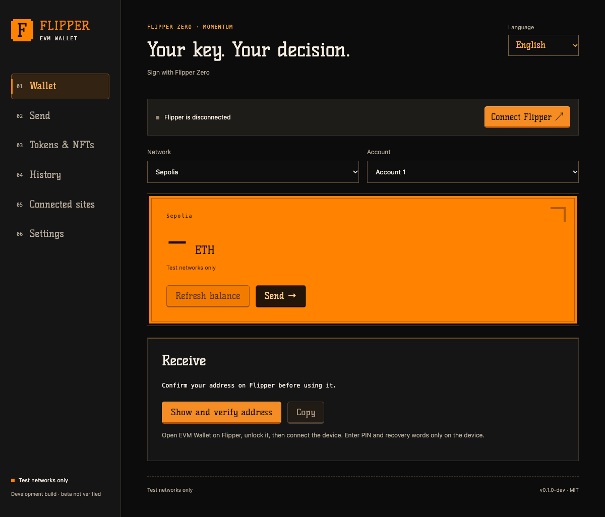

# Flipper EVM Wallet

An open source **testnet-only development wallet** for stock Flipper Zero running Momentum, with a Chrome Manifest V3 extension and direct WebHID transport.

**Development build. Not an accepted public beta. Not audited. Never import a real wallet or use real assets.** The physical approval, recovery and real-network acceptance gates are still open ([hands-on checklist](docs/HARDWARE_ACCEPTANCE.md)). See [current evidence and remaining work](docs/STATUS.md).



## Implemented

- C application for Momentum `mntm-012`, API `87.1`, and a portable C signing core.
- Device-only 24-word BIP39 creation/recovery, backup quiz, five BIP44 Ethereum accounts, 8–12 digit PIN, PIN change and lock.
- PBKDF2-HMAC-SHA256 at 100,000 iterations, authenticated ChaCha20-Poly1305 storage and additional device-unique AES wrapping. Interrupted-write recovery logic.
- Vendor USB HID protocol with session/request binding, bounded framing, cancellation and immutable review data. No raw-hash signing command.
- Firmware policy for Sepolia, Base Sepolia and Arbitrum Sepolia. ETH transfers, ERC20 transfers/bounded allowances, ERC721 and ERC1155 single transfers, restricted SIWE.
- EIP2612 parser and hashing with a versioned contract allowlist. **The production allowlist is empty until deployments are confirmed. Permit signing is therefore currently refused.** Host-only fixture coverage is separate.
- EIP1193/EIP6963 provider, site permission prompts/revocation, local history, watched token/NFT contracts, UI in English by default, with English, Bulgarian, German, Spanish and French options, fixed testnet RPC providers with chain-ID checks.
- Flipper-inspired black/orange interface with locally bundled Kelly Slab for vintage terminal-style headings and controls, including Bulgarian Cyrillic. Flat, tactile action buttons use the same display style. Addresses and form values use a readable monospace font.
- Native vectors, parser mutation tests, storage failure models, real isolated-browser tests, contract fixtures, CI and development packaging.

This is a call decoder, not a contract behavior verifier. Unknown token names and decimals are not trusted. Amounts are shown in wei or raw units. Sepolia and Arbitrum Sepolia show the signed total gas fee cap. Base Sepolia transaction signing is currently refused because EIP-1559 does not cap its separate L1 fee. Supporting Base transactions requires an explicit change to the strict total-fee requirement; see [fee policy](docs/FEE_POLICY.md).

## Start here

1. Read [security limitations](SECURITY.md) and [the user guide](docs/USER_GUIDE_BG.md).
2. Build with the [pinned build instructions](docs/BUILD.md).
3. Install `dist/flipper_evm_wallet.fap` under `/ext/apps/Tools/` with qFlipper.
4. Load `dist/extension` as an unpacked extension in a dedicated Chrome test profile.
5. Create a fresh **test** wallet on Flipper. Keep PIN and recovery words off the computer.
6. Use `npm run demo` for the local demonstration. Test assets require separate confirmed deployments and faucet funds.

qFlipper cannot communicate with the device while the wallet owns the USB interface. This is intentional. Exit the wallet physically to restore the normal USB interface. The `probe` launch argument is a bounded, read-only engineering self-test using public zero-entropy vectors; it never loads a user wallet or returns a signature.

## Validation commands

```sh
python3 -m venv .venv
.venv/bin/pip install -r requirements-dev.txt
npm ci --ignore-scripts
cmake -S . -B build/native -DSANITIZE=ON
cmake --build build/native --parallel
ctest --test-dir build/native --output-on-failure
npm run test:vectors
npm run typecheck
npm test
npm run build
npx playwright install chromium
node tests/browser.mjs
npm run contracts:build
forge test
scripts/setup-sdk.sh
scripts/build-firmware.sh
node scripts/package.mjs
```

Use Node 22.22.3 and npm 12.2.1. Local Apple Clang ASan fails even for an empty program on the tested macOS host; local C tests use UBSan, while Linux CI uses ASan plus UBSan. Browser tests use an isolated Chromium profile and do **not** count as Chrome-to-hardware signing tests.

## Project map

| Directory | Responsibility |
| --- | --- |
| `core/` | Policy, RLP/ABI, SIWE/Permit, vault, transport and approval state |
| `firmware/` | Momentum UI, physical buttons, USB, Bluetooth isolation, storage |
| `extension/` | Browser UI, provider bridge, origin permissions, RPC, WebHID |
| `contracts/` | Testnet-only public faucet fixtures and deployment manifest |
| `tests/` | Independent vectors, negative tests, browser and storage models |
| `docs/` | Threat model, protocol, recovery, acceptance and pilot |

## License and relationship to other projects

Original code: [MIT](LICENSE). The pinned subset of Trezor crypto retains its original notices and [license](vendor/trezor-crypto/LICENSE); see [dependency notes](docs/DEPENDENCIES.md). Bundled extension packages include their license texts. Momentum/uFBT are external GPL tools/firmware; their licenses remain unchanged. This project is independent and is not endorsed by Flipper Devices, Trezor or any wallet vendor.

Commercial reuse is permitted by MIT. Paid support and integrations are proposed pilot services, not validated revenue or a security certification. [Pilot outline](docs/PILOT.md).
