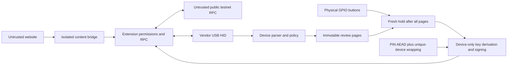

# Threat model and trust boundaries

## Assets and assumptions

The wallet seed, derived private keys and user approval are the protected assets. Test ETH and test NFTs are the only supported assets. The device firmware, FAP and crypto library must be authentic and uncompromised. Stock Flipper has no verified-boot/security-isolation guarantee against its owner, debugger or replacement software.

## Controls

| Threat | Control | Remaining limitation |
| --- | --- | --- |
| Website claims another origin | Background uses browser sender URL, top frame and document ID; navigation cancels | A compromised host can fabricate all traffic to Flipper |
| Silent address disclosure | Per-origin grants and physical address confirmation | Approved sites can retain public addresses |
| Secret export via USB | No secret, PIN, mnemonic or raw-hash commands | Malicious firmware/debugging bypasses the app |
| Message modification | Session/request/sequence checks; review owns a copy of hash/fields | Host can propose a new malicious transaction; user must inspect it |
| Approval injection | Software input cancels; GPIO must be low; fresh release/2s hold; every page rendered | GPIO/screen themselves are trusted firmware interfaces |
| Pre-held/replayed approval | Release state resets on page navigation and request replacement; one-shot approval | Human attention is not measurable |
| Concurrent traffic/unplug/timeout | Cancel and invalidate; no signature response after detected disconnect/queued competing traffic | In-flight crypto finishes before its stack can be scrubbed |
| Malicious ABI/RLP | Canonical bounded parsing, exact lengths, supported selectors only | Supported selector does not establish actual contract behavior |
| Mainnet or arbitrary hash | Firmware chain allowlist; no raw-hash protocol command | Modified firmware remains out of scope |
| Stolen SD contents | PBKDF2 100k, random salt, AEAD; device slot11 wrapping | PIN guessing with device access, SD rollback, old sectors, firmware attacks |
| Partial record write | Write+sync+readback, previous committed record, rename+readback | FAT/SD power-cut durability still needs physical testing |
| Radio/RPC input | Disconnect Bluetooth, stop normal and extra advertising, wallet-only USB | Platform/API behavior must be measured on each Momentum version |
| RPC manipulation | Check eth_chainId, verify returned signatures, fixed endpoints | Balances, simulation and inclusion are not independently trusted; Base signing is blocked |

## Policy details

- New wallets use 256 bits from the hardware random source, BIP39 24 words, empty mnemonic passphrase and five BIP44 EVM accounts.
- ERC20 allowance upper bound is below 2^128. Zero explicitly revokes. uint256 unlimited sentinel is refused.
- EIP1559 fields are canonical: chain<=32bits, nonce<=64bits (extension<=53bits), gas<=32bits, fees<=64bits, value<=256bits, 20-byte recipient, empty access list. Contract creation is not supported.
- SIWE requires the connected account and matching host origin/URI, checksum address, supported test chain, alphanumeric nonce, UTC time fields and bounded ASCII text. Resources/request ID/alternate schemas/time offsets are refused. Fractional UTC seconds up to nine digits are parsed conservatively at whole-second resolution.
- Permit uses the device's compiled contract name/version/address/chain registry. The initial production registry is empty. Native tests use a separate public fixture registry.
- All unsigned bytes are hashed on device. The extension verifies signatures against the selected account before broadcast.

## Exclusions and outstanding work

No certification, external audit, secure-element equivalence, hardware anti-rollback, seed protection under arbitrary physical access, third-party contract correctness, Base transaction support or mainnet safety claim. See `acceptance.json` for remaining gates. Host parser mutations and mocked storage faults are not hardware adversarial proof.
